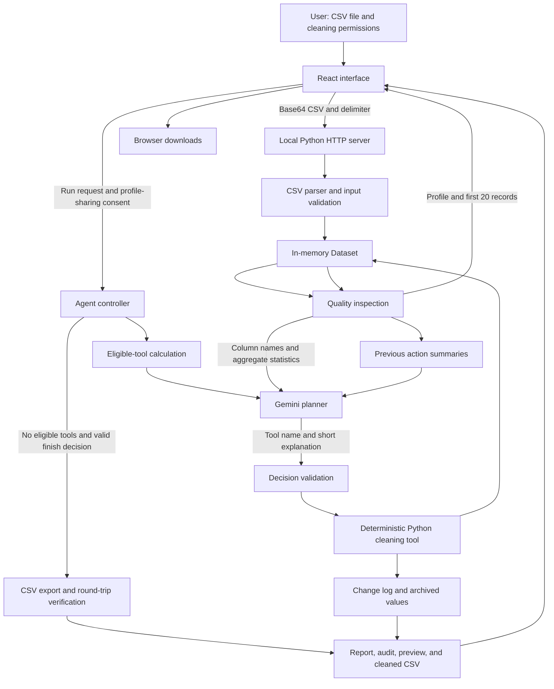
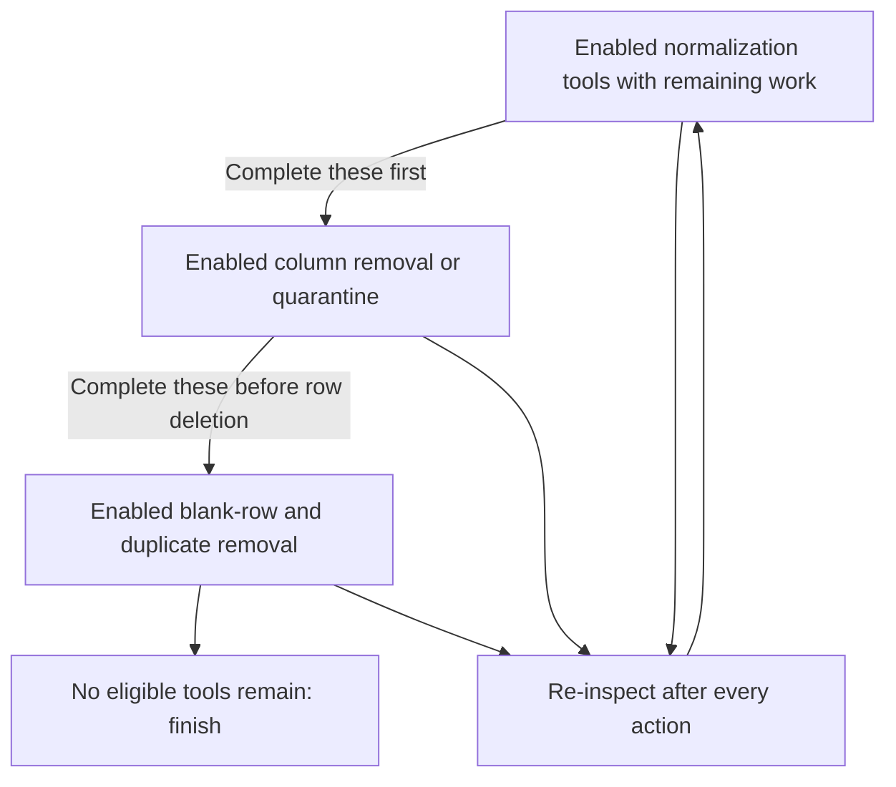
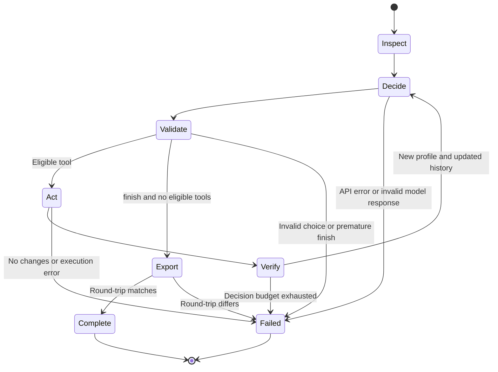

# Dataset Cleaning Agent — detailed system schema

This describes the implemented app, including the empty-column removal and sparse-column archive tools. It separates the model's decisions from the rules enforced by the program.

## 1. System architecture



### Responsibility of each layer

| Layer | Implementation | Responsibility |
|---|---|---|
| User interface | `src/main.jsx`, React | Upload, permissions, previews, status, activity log, and downloads |
| Styling | `src/styles.css`, Tailwind CSS | Responsive layout and visual states |
| Build | Vite, `vite.config.js` | Bundle the interface into `dist/`; proxy API requests during development |
| Local API | `server.py`, standard-library HTTP server | Validate incoming requests, parse files, start the agent, stream events, and return results |
| Dataset and inspection | `cleaner.py` | Maintain table contents and provenance; calculate quality statistics |
| Agent controller | `run_agent()` | Coordinate repeated inspection, planning, tool execution, logging, and termination |
| Model adapter | `gemini.py`, `GeminiPlanner` | Construct Gemini requests and validate structured decisions |
| Cleaning tools | `apply_tool()` | Perform the eight supported transformations |
| Review checks | `review_issues()` | Flag unresolved issues without editing uncertain values |
| Exports | Python serialization and browser download helpers | Produce cleaned CSV, Markdown report, JSON audit, and extra-values CSV |

The server listens on `127.0.0.1:8000` by default. The app has one Gemini planner, no database, no model training, no vector store, and no separate agent workers.

## 2. Complete request sequence

```mermaid
sequenceDiagram
    actor User
    participant UI as React interface
    participant API as Local Python server
    participant Core as Dataset and agent controller
    participant Model as Gemini API
    User->>UI: Choose a CSV
    UI->>API: POST /api/inspect
    API->>Core: Decode, parse, validate, inspect
    Core-->>API: Profile, headers, preview records
    API-->>UI: JSON inspection response
    User->>UI: Choose permissions and allow profile sharing
    User->>UI: Run cleaning agent
    UI->>API: POST /api/clean
    API->>Core: Reparse original CSV and copy Dataset
    Core-->>UI: inspect event
    loop Each decision, up to 12 steps
        Core->>Core: Calculate eligible tools from current data
        Core-->>UI: decide event
        Core->>Model: Profile, eligible tools, previous results
        Model-->>Core: Tool name and short reason
        alt Allowed cleaning tool
            Core->>Core: Validate choice and execute tool
            Core-->>UI: act event
            Core->>Core: Log changes and re-inspect data
            Core-->>UI: verify event
        else finish and no eligible tools remain
            Core-->>UI: finish event
        else Invalid choice or provider failure
            Core-->>UI: error event
        end
    end
    Core->>Core: Serialize CSV and parse it again
    Core->>Core: Compare headers and rows; assemble audit and review
    Core-->>API: Verified data, CSV text, report
    API-->>UI: result event
    User->>UI: Download chosen outputs
    UI-->>User: Files generated from returned result
```

The browser keeps the encoded original file in memory. `/api/clean` submits it again, so cleaning begins from the original upload rather than the preview or a previous cleaned result.

## 3. Upload and parsing rules

The browser reads the selected file with `FileReader`, encodes its bytes as Base64, and sends a JSON request to the local server. Base64 transports the bytes; it is not encryption.

The server checks the request's origin when present, requires `application/json`, and accepts a request body of at most 8 MiB to accommodate Base64 overhead. The decoded file must be non-empty and at most 5 MiB.

`parse_csv()` then:

1. Detects BOM-marked UTF-16; otherwise decodes using UTF-8 with optional BOM removal.
2. Rejects binary null characters.
3. Uses the selected delimiter, or attempts detection from the first 65,536 characters. If detection fails, it tries a comma.
4. Parses quoting with Python's strict CSV reader.
5. Treats the first record as column headers.
6. Checks the maximum of 25,000 data records and 100 columns.
7. Converts an entirely blank CSV record into an empty row of the expected width.
8. Rejects any other record whose width differs from the header width.
9. Assigns original record and column identifiers.

The supported delimiters are comma, semicolon, tab, and pipe. Quoted commas and embedded newlines are handled by the CSV parser. Record identifiers count parsed CSV records, not physical file lines.

## 4. Internal Dataset schema

All cell values remain strings.

| Field | Type | Meaning |
|---|---|---|
| `headers` | `list[str]` | Current column labels |
| `rows` | `list[list[str]]` | Current rectangular table of data values |
| `row_ids` | `list[int]` | Original CSV record number for each surviving row, beginning at 2 |
| `delimiter` | `str` | Original detected or selected separator |
| `encoding` | `str` | Input decoding convention |
| `column_ids` | `list[int]` | Original one-based column number for each surviving column |
| `original_headers` | `list[str]` | Original labels, retained even after renaming or removing columns |

For example, removing original column 2 from a four-column table leaves `column_ids = [1, 3, 4]`. An edit to the new second column is still logged against original column 3. A deleted row likewise does not renumber the remaining records in the audit.

`Dataset.copy()` creates separate working rows, headers, and identifier lists. The cleaning tools mutate that working copy. The original uploaded file is not overwritten.

## 5. Inspection schema

`inspect()` calculates the following overall metrics:

| Field | Calculation |
|---|---|
| `rows` | Number of data records |
| `columns` | Number of current headers |
| `missing_cells` | Cells whose value is empty after trimming for inspection |
| `whitespace_cells` | Cells whose stored value differs from its trimmed form |
| `duplicate_rows` | Additional copies of identical complete rows |
| `blank_rows` | Rows with no non-whitespace values |
| `header_changes_needed` | Headers differing from the proposed unique, trimmed labels |
| `column_profiles` | Per-column statistics and inferred type hints |

Each column profile contains:

```text
index                 Current zero-based position
name                  Current label
kind                  identifier | numeric | text
original_column       Original one-based position
originally_unnamed    Whether the original header was blank after trimming
missing               Number of empty / whitespace-only cells
unique                Distinct non-empty stored values
numeric_values        Number of present values recognized as numeric
present               Number of non-empty values
```

Type inference is a hint for tool eligibility and review checks, not conversion of CSV storage types. The identifier heuristic looks for tokens such as `id`, `code`, `zip`, `postal`, `phone`, `mobile`, `account`, and `serial`, or values with leading zeros. Numeric inference requires every present value in a non-identifier column to parse as a supported finite decimal.

## 6. Tool permissions and eligibility

For a tool to be offered to Gemini, both conditions must hold:

```text
User permission is enabled
AND
The current dataset contains work that the tool can perform
```

| Tool | Default | Eligibility | Transformation |
|---|---|---|---|
| `trim_whitespace` | On | At least one cell has leading/trailing whitespace | Apply `strip()` to cell values |
| `normalize_headers` | On | Blank, padded, or duplicate headers exist | Trim headers, generate `column_N` for blanks, add unique suffixes |
| `normalize_missing` | On | A cell exactly matches a user-supplied marker | Replace that exact text with an empty string |
| `normalize_numbers` | Off | Valid thousands-grouped values exist in wholly numeric, non-identifier columns | Remove thousands commas without changing other formatting |
| `remove_empty_columns` | On | Columns contain no non-whitespace values, and removal would leave at least one column | Remove those columns from the main table |
| `quarantine_sparse_columns` | On | Originally blank headers, with more than 0% but less than 1% populated cells; removal leaves at least one column | Archive their non-empty cells and remove those columns from the main table |
| `remove_blank_rows` | On | Rows contain only stored empty strings | Remove those rows |
| `remove_duplicates` | Off | Identical complete rows exist | Keep the first copy and remove later copies |

Missing markers are exact and case-sensitive. There are no default text markers: `NA`, `NULL`, `N/A`, and `C` remain text unless the user explicitly provides them.

The sparse-column rule is a fixed heuristic, not a conclusion independently invented by Gemini. Named sparse columns are retained. An unnamed column populated at exactly 1% or more is retained. Column removal is not offered when there are no data rows. Each column-removal tool refuses a selection that would remove all remaining columns.

### Ordering constraints



These are eligibility stages, not a hardcoded total order. If normalization work exists, the controller temporarily withholds column and row removal. Once normalization finishes, eligible column tools are offered before row deletion. Gemini chooses among the tools offered at that step. Its instruction also asks it to prioritize header/whitespace cleanup and blank-row removal before duplicate removal.

Reinspection matters: trimming whitespace may create duplicates; normalizing missing markers may create empty columns; removing extra columns may reveal duplicate rows that previously differed only in those extras.

## 7. Gemini request and decision schema

The configured planner is Gemini, defaulting to `gemini-3.5-flash-lite`. Each step makes a separate `generateContent` request. Models whose names begin with `gemini-3` receive the `LOW` thinking setting. Each request has a 45-second timeout.

Gemini receives a JSON representation of:

```text
profile             Current inspection statistics and column labels
candidate_tools     Offered tool names, descriptions, and affected counts
previous_results    Previous tool choices, reasons, change counts, and resulting dimensions
```

Raw rows and archive contents are not sent. Column labels can still contain sensitive text, which is why the interface requests acknowledgement of profile sharing.

The requested decision has this shape:

```json
{
  "tool": "remove_empty_columns",
  "reason": "Two columns contain no values and can be removed."
}
```

The output JSON schema contains only `tool` and `reason`, requires both, disallows extra properties, and constrains `tool` to the current offered names. If there are no offered tools, the only allowed choice is `finish`.

The adapter additionally checks that Gemini returned a completed candidate, parses its text as JSON, checks membership of the chosen tool, and requires a non-empty explanation of at most 2,000 characters. The controller validates the choice again before executing a tool.

The API key is read on the server from configuration and sent to Google's API as the `x-goog-api-key` header. It is not included in browser requests or responses. The JSON output format is configured with `responseFormat.text.mimeType = APPLICATION_JSON`.

## 8. Agent state machine



The controller has a maximum of 12 decisions, including the terminating decision. A tool must produce at least one logged change. The controller aborts rather than repeatedly calling a tool that makes no progress.

The action history is short-term, per-run memory. Each new Gemini request receives the accumulated summaries. The app has no cross-run memory or learning from earlier uploads.

## 9. Local API contracts

| Endpoint | Method | Purpose | Return format |
|---|---|---|---|
| `/api/status` | GET | Check whether a local key is configured and report the model name | JSON |
| `/api/sample` | GET | Read the included synthetic lab CSV | CSV text |
| `/api/inspect` | POST | Validate, parse, profile, and preview an upload | JSON |
| `/api/clean` | POST | Run the agent on the original upload | Streamed newline-delimited JSON |
| `/` and built assets | GET | Serve the React build from `dist/` | HTML, JS, CSS, etc. |

`/api/status` checks whether a key is present. It does not make a provider call or establish that the key has valid permissions or quota.

### Inspection request

```json
{
  "file": "<Base64-encoded CSV bytes>",
  "delimiter": "auto"
}
```

### Inspection response

```text
profile      Full calculated profile
headers      Original column labels
rows         First 20 data records
delimiter    Detected or selected separator
encoding     Input decoding convention
```

### Cleaning request

```json
{
  "file": "<Base64-encoded CSV bytes>",
  "delimiter": ",",
  "allow_profile_transfer": true,
  "options": {
    "trim_whitespace": true,
    "normalize_headers": true,
    "normalize_missing": true,
    "normalize_numbers": false,
    "remove_empty_columns": true,
    "quarantine_sparse_columns": true,
    "remove_blank_rows": true,
    "remove_duplicates": false,
    "missing_markers": []
  }
}
```

### Stream events

| `phase` | Meaning | Main additional fields |
|---|---|---|
| `inspect` | Initial dataset inspected | `message`, `profile` |
| `decide` | Waiting for Gemini's next choice | `message`, `step` |
| `act` | A validated tool is about to execute | `tool`, `message`, `step` |
| `verify` | Tool completed and profile recomputed | `step`, `tool`, `reason`, `changes`, `rows_after`, `columns_after`, `missing_after`, `message` |
| `finish` | Gemini selected termination | `message`, `step` |
| `result` | Export verified and report assembled | `csv`, `report`, `headers`, first 20 `rows`, `row_ids`, `column_ids` |
| `error` | Run stopped without an exportable result | `message` |

The UI reads the response in chunks, decodes UTF-8 incrementally, splits complete lines, and parses each line as JSON. A `finish` event precedes export verification; a valid `result` event is what makes downloads available.

## 10. Audit and archive schemas

### Cell or header edit

```json
{
  "record": 2,
  "column": 3,
  "before": " 1200 ",
  "after": "1200",
  "tool": "trim_whitespace"
}
```

For a header edit, `record` is 1. Coordinates refer to the original input.

### Removed row

```json
{
  "record": 12,
  "before": ["010", "Steel", "1890"],
  "after": null,
  "tool": "remove_duplicates"
}
```

### Removed or archived column

```json
{
  "record": 1,
  "column": 10,
  "before": "column_10",
  "after": null,
  "tool": "quarantine_sparse_columns",
  "archived_values": [
    {"record": 17135, "value": "2022"}
  ]
}
```

The archive is flattened for download:

```text
record            Original CSV record number
original_column   Original one-based column position
header            Column label at removal time
value             Preserved cell text
```

The browser's archive CSV labels these as `original_record,original_column,header,value`.

The full report includes `planner`, `model`, `before`, `after`, `options`, `actions`, `changes`, `review`, `verification`, surviving original record and column numbers, `quarantine`, export settings, notes, and input/output SHA-256 hashes.

An action's `changes` count means logged operations, not always cells: header edits count headers, row removals count records, and column removals count columns. An archived column may contain multiple values within one logged column removal.

## 11. Verification and human review

Per-action verification recomputes the profile and records the resulting counts. This verifies progress, not the domain meaning of every value.

Final export verification:

1. Serialize the cleaned table using its separator and newline-aware CSV writer.
2. Parse that serialized text again.
3. Compare the parsed headers and rows exactly with the in-memory cleaned table.
4. Confirm that no enabled, eligible fixes remain.
5. Calculate the output SHA-256; the server also calculates the input file hash.

The output hash is over UTF-8 CSV text before the browser adds a UTF-8 BOM to the cleaned download. Verification protects against serialization errors; it does not prove that a sparse-column heuristic is suitable for every dataset.

Review findings include remaining empty cells, retained identical rows, unresolved headers, empty columns, mostly numeric columns containing text markers, suspected numeric outliers, ambiguous day/month dates, and quarantined values.

For numeric outliers, the implemented check requires at least four present values in a fully numeric, non-identifier column and uses the bounds `Q1 - 1.5 × IQR` and `Q3 + 1.5 × IQR`. Outliers are retained. Ambiguous dates are retained. Missing values are not imputed. Text markers are not replaced unless selected by the user.

## 12. Your enterprise-survey example

The verified input had 23,220 records and 16 columns. The first seven columns were named; nine extra columns had blank original headers.

| Stage | Rows | Columns | Outcome |
|---|---:|---:|---|
| Inspection | 23,220 | 16 | Nine unnamed extra columns detected |
| Header normalization | 23,220 | 16 | Nine blank labels given unique names |
| Empty-column removal | 23,220 | 14 | Two columns with no values removed |
| Sparse-column archive | 23,220 | 7 | Seven originally unnamed columns archived and removed |
| Final verification | 23,220 | 7 | Export matches cleaned data |

There were 208,691 empty cells in the original 16-column table and none in the resulting seven-column main table. That reduction came from removing extra columns; no values were invented or filled.

The archive contains 289 extra cells. Manual inspection during debugging established that 287 cells form 41 copies of seven-field records already present in the main table; the remaining two cells are isolated numbers. The generic agent uses the unnamed/sparse rule to archive these columns. It does not independently perform that record-block interpretation.

An additional equality check during verification confirmed that the cleaned rows equal the first seven fields of every original row. All 400 `C` markers were preserved.

## 13. Failure paths and limitations

| Condition | Behavior |
|---|---|
| Missing local key | Cleaning cannot start; local inspection remains available |
| Wrong separator or inconsistent record widths | Reject the file and identify the mismatched record |
| Invalid quoting or unsupported encoding | Reject the file with a parsing message |
| Gemini rejects the request | Report an error; HTTP 400 provider detail is redacted and truncated |
| Model denied, unavailable, or quota exhausted | Show the corresponding provider-access error |
| Response timeout | Stop with a retry message after the request timeout |
| Invalid decision or premature finish | Stop before exporting a result |
| Tool makes no changes | Stop to avoid a non-progressing loop |
| 12-decision limit reached | Stop without a downloadable result |
| Export does not round-trip exactly | Stop without a downloadable result |
| Browser cancels | Abort its request; the server detects disconnect when it next writes an event |

Cancellation does not guarantee instantaneous cancellation of an in-flight Gemini request. The web UI requires a valid `result` event before showing downloads. Failed-run working changes are not committed to the original file.

The normal app keeps uploads, work tables, and results in memory. Browser refresh loses the current upload/result state. There is no session database, job queue, authentication system, automatic retry, progress resumption, or offline planner fallback. The `outputs/` files produced during debugging were saved by separate local verification scripts, not automatic storage in the web request handler.

This app handles structural and format cleanup within fixed policies. It does not infer units, reconstruct broken business records, train a cleaning model, fill missing financial measurements, or prove domain correctness. Gemini's role is choosing the next eligible action and explaining that choice; Python owns the cleaning policy and transformations.

## 14. Short presentation description

The user uploads a CSV and chooses permitted fixes. Python profiles the dataset and determines which cleaning tools are currently eligible. Gemini chooses one of those tools and explains its choice. Python validates the decision, executes the tool, logs the changes, and feeds the updated profile into the next decision. When all enabled fixes are complete, the app verifies the CSV export and returns the cleaned table, audit report, and any archived extra values.
